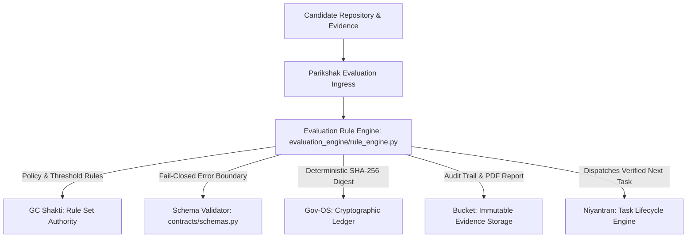

# Architecture Decision Record (ADR): PARIKSHAK Evaluation Engine (Gov-OS Core Compliance)

**Document ID**: `ADR-PARIKSHAK-GOV-002`  
**Status**: `ACCEPTED`  
**Standard**: `Governed Operational System (Gov-OS) Core Compliance`  
**Target Product**: `Parikshak Engineering Review Runtime (PARIKSHAK)`  
**Author**: Kanishk Singh  
**Date**: 2026-11-19  

---

## 1. Context & Problem Statement
Following the 100/100 PASS on `T-OUT-OF-SYLLABUS`, the mission requires implementing and verifying the standalone **Evaluation Engine** for the **Parikshak Engineering Review Runtime**.

The objective is to establish an auditable, deterministic evaluation capability adhering to **Gov-OS Core Compliance**:
1. **Rule-Based Autonomous Verification**: Inspect candidate repositories, verify execution evidence, and compute objective weighted scores (0–100) and verdicts (`PASS`/`FAIL`).
2. **Prohibition of Forbidden Anti-Patterns**:
   - `workflow_execution_engine`: The evaluation engine must strictly evaluate and attest truth; it must never bypass or masquerade as the Niyantran lifecycle engine.
   - `direct_masterdb_schema_mutation`: Under Gov-OS doctrine, schema migrations and master DB state modifications must never occur directly during an evaluation run. All results are published as immutable evidence.
3. **Deterministic Replay Audit**: Executing an evaluation 50 times on identical inputs must yield the exact same SHA-256 verdict hash with zero drift.
4. **Fail-Closed Error Boundaries**: Malformed payloads or invalid evaluation specifications must return clean 400/422 responses; unhandled 500 exceptions are strictly prohibited.
5. **Government-Grade Evidence Packaging**: Generate cryptographic audit packets and printable PDF inspection records via `reportlab`.

---

## 2. Integration Block Topology

---

## 3. Core Architectural Decisions

### 3.1 Separation of Concerns & Forbidden Pattern Boundaries
- **No Direct Schema Mutations**: The engine operates purely functional and read-only over inputs. State results are emitted as signed `EvaluationVerdict` and `EvidencePacket` structures.
- **No Workflow Execution Hijack**: Orchestration is reserved for Niyantran; Parikshak evaluates criteria and issues attestations without direct process mutation.

### 3.2 Evaluation Rules Schema (v1.0)
Rules are defined as structured criteria:
- `SCHEMA_COMPLIANCE` (Weight: 20%)
- `TEST_PASS_RATE` (Weight: 30%)
- `DETERMINISM_PROOF` (Weight: 30%)
- `ERROR_BOUNDARY_COVERAGE` (Weight: 20%)

Each rule assesses evidence deterministically. A composite score $\ge 85$ with zero critical failures yields `PASS`.

### 3.3 50-Run Determinism Standard
The evaluation outcome (rule breakdown, total score, and verdict) is serialized into canonical sorted JSON and digested with SHA-256. Running 50 consecutive evaluations on identical input yields bit-identical hashes.

---

## 4. Consequences & Compliance
- **Compliance**: Full conformity with Gov-OS Core Compliance and PARIKSHAK PKB standards.
- **Traceability**: Every review produces an immutable verification hash recorded in `review_packets/REVIEW_PACKET.md` and signed for Gov-OS ledger inclusion.
