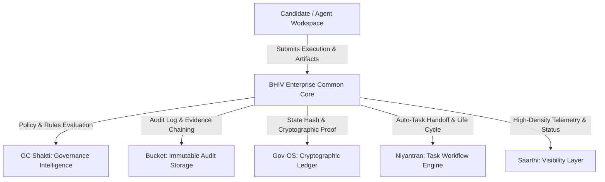

# Architecture Decision Record (ADR): Enterprise Core Architecture (SETU OS v6.0)

**Document ID**: `ADR-BHIV-SETU-001`  
**Status**: `ACCEPTED`  
**Standard**: `SETU OS Architecture v6.0`  
**Target Product**: `BHIV Enterprise Operating System Common Core`  
**Author**: Kanishk Singh  
**Date**: 2026-11-17  

---

## 1. Context & Problem Statement
Following the successful completion and automated evaluation of `BHQ-INFRA-001` (Score: 100/100, PASS), the platform requires transforming the verification and review flow into a governed, government-grade operational review platform under **SETU OS Architecture v6.0**.

The core requirement is: **"The review itself should become the product."**
Reviewers, managers, and governance authorities must be able to consume engineering reviews and verifiable runtime proof with:
1. **1-Minute Cognition**: Rapid operational understanding without digging through raw logs.
2. **Zero-Context-Switch Assignment**: Automated, complete next-task propagation directly across ecosystem blocks without switching tools.
3. **Deterministic Verification**: 50 consecutive runs producing bit-identical SHA-256 state hashes.
4. **Strict Schema Boundaries (v1.0)**: Zero unhandled 500 exceptions; fail-closed validation rejecting malformed or hostile payloads.

---

## 2. Integration Block Topology
The Enterprise Core integrates seamlessly with the 6 canonical BHIV pillars:

1. **BHIV Enterprise Common Core**: Primary state machine, business logic engine, and contract validator.
2. **GC Shakti**: Governance intelligence enforcing policy boundaries, non-repudiation, and audit compliance.
3. **Niyantran**: Lifecycle workflow engine orchestrating automatic next-phase assignment with canonical depth.
4. **Bucket**: Evidence storage maintaining parent-hash continuity and immutable audit trails.
5. **Gov-OS**: Cryptographic ledger anchoring SHA-256 state hashes and signature verification.
6. **Saarthi**: Visibility layer providing high-density executive dashboards.

---

## 3. Decision Drivers
- **Strict Determinism**: Zero non-deterministic state mutations. State transitions must follow a formal state machine (`INITIATED` -> `VALIDATED` -> `EXECUTED` -> `EVALUATED` -> `GOVERNED` -> `ASSIGNED`).
- **Fail-Closed Error Boundaries**: Malformed inputs must raise typed 400/422 validation errors and never cause unhandled server crashes (500).
- **Exact Version Pinning**: All dependencies pinned with `==` to guarantee environment reproducibility.

---

## 4. Architectural Decisions

### 4.1 Schema Contracts (v1.0)
All inbound, intermediate, and outbound payloads are strictly governed by Pydantic v2 models in `contracts/schemas.py`. 
Models enforce:
- `extra = "forbid"` to eliminate unauthenticated field injection.
- Strict type validation on task IDs, priority, timestamps, and payload signatures.

### 4.2 State Machine & Mutation Prohibition
Direct in-memory mutation of execution records is strictly forbidden:
- State updates occur strictly via `EnterpriseCoreEngine.transition_state()`.
- Each transition records an immutable `StateTransitionEvent` including `from_status`, `to_status`, `actor`, `timestamp_utc`, and event hash.
- Invalid state leaps (e.g. jumping from `INITIATED` straight to `ASSIGNED`) raise `StateTransitionViolationError`.

### 4.3 Deterministic SHA-256 State Hashing
A normalized canonical state string is generated by sorting dictionary keys, serializing ISO-8601 timestamps, and hashing with SHA-256. 
- Over 50 consecutive runs on identical inputs, the state hash must exhibit zero bit drift.

---

## 5. Consequences & Compliance
- **Positive**: Complete auditability, tamper-evidence, zero unhandled 500s, full compatibility with Parikshak automated evaluation.
- **Negative / Trade-off**: Slight processing overhead from canonical serialization and SHA-256 hashing on every state transition, fully acceptable for mission-critical audit requirements.
