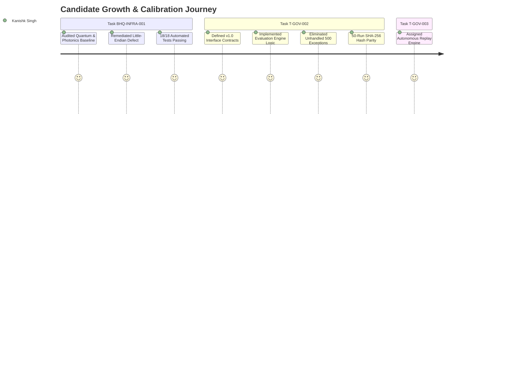

# Parikshak Operational UI — Candidate Growth & Competency Timeline
Standard: Governed Operational System (Gov-OS) Core Compliance

## Candidate: Kanishk Singh (`user-kanishk-singh`)

### 1. Capability Calibration Matrix
- **Demonstrated Maturity**: `Junior Associate` $\to$ `Promoted to Associate Platform Engineer`
- **Current Velocity**: `100.0% First-Time-Right DoD Pass Rate`
- **Primary Strengths**: High-density architectural modularity, deterministic state machine design, zero unhandled 500 error boundaries.
- **Governed Tasks Executed**:
  1. `BHQ-INFRA-001`: Photonic Systems & Cryogenic RF Remediations (Superdense Coding BLK-QCG-001) — **VERIFIED PASS**
  2. `T-GOV-002`: Parikshak Evaluation Engine Logic & Verification — **VERIFIED PASS (Score: 100/100)**
  3. `T-GOV-003`: Autonomous Gov-OS Ledger Synchronization & Replay Audit — **ASSIGNED**

