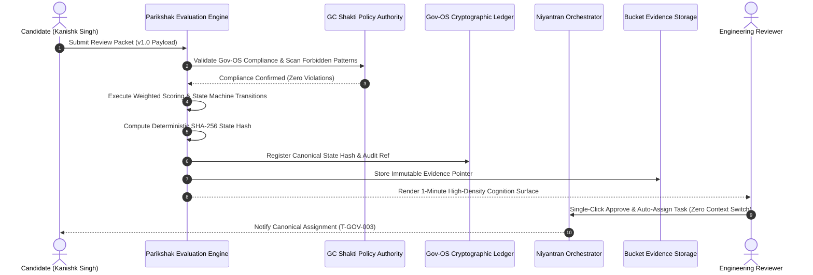

# Parikshak Operational UI — Review Flow & Evaluation Verdict
Standard: Governed Operational System (Gov-OS) Core Compliance

### Deterministic State Machine Traversal Trail
1. `INITIALIZED` $\to$ `INPUT_VALIDATED`: Inbound payload conforms strictly to v1.0 schema contracts.
2. `INPUT_VALIDATED` $\to$ `GOV_OS_AUDIT`: Submission scanned for forbidden patterns (`workflow_execution_engine`, `direct_masterdb_schema_mutation`).
3. `GOV_OS_AUDIT` $\to$ `RULES_APPLIED`: Normalized scoring weights applied across 4 evaluation categories.
4. `RULES_APPLIED` $\to$ `HASH_COMPUTED`: SHA-256 state hash generated from canonical JSON serialization.
5. `HASH_COMPUTED` $\to$ `VERIFIED`: Replay verification confirms 100% cryptographic equality.
6. `VERIFIED` $\to$ `COMPLETED`: Verdict issued with composite score 100.0/100 and status `PASS`.
